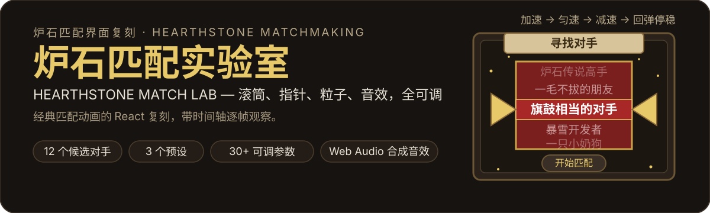
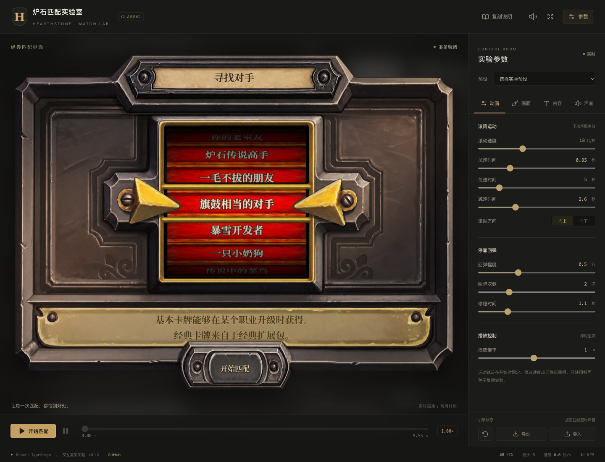

<p align="right"><a href="README.md">中文</a></p>

<p align="center">
  
</p>

<p align="center">
  <a href="https://hearthstone-match.xiaosang.cc/">▶ Try Online</a>
  ·
  <a href="https://github.com/holynova/hearthstone-match">GitHub Repository</a>
</p>

Hearthstone Match Lab is a React recreation of the classic Hearthstone matchmaking screen — golden frame, red nameplate roller, twin pointers — with every part of the animation tunable: acceleration, cruise, deceleration, rebound settle. Hit 「开始匹配」 ("Start Match") and watch the roller spin; scrub the timeline to inspect pointer shake and particles frame by frame. All sound is synthesized live with Web Audio, no audio files.

## Screenshots

<p align="center">
  
</p>

<p align="center">
  
</p>

## What's Tunable

- **Animation**: scroll speed, acceleration / cruise / deceleration / settle durations, scroll direction, rebound amplitude and count, playback rate.
- **Visuals**: pointer shake, blur, glow, font size, zoom, brightness, particle count / speed / lifetime / gravity / size.
- **Content**: title, bottom tip, candidate opponent list (one per line, with `|` to set weights), forced match result, random seed.
- **Sound**: master volume, mechanical sound, success sound, background music volume, mute.
- **3 presets**: classic recreation, slow-motion observation, cinematic effects — switch with one click.
- **Import / export**: save a config as JSON to share, or import someone else's config to replay the exact same match; the same random seed guarantees a reproducible result.

The default 12 candidate opponents: your old roommate, a Hearthstone master, a stingy friend, a worthy opponent, a Blizzard developer, a little puppy, a legendary noob, an angry chicken, a StarCraft champion, the innkeeper, a very slow player, your best friend.

## Frame-by-Frame

The timeline at the bottom can be paused and scrubbed; combined with the slow-motion preset, it reveals how the roller's speed and pointer shake change at each stage. The engine status bar shows live FPS, particle count, and current speed. A match has 7 stages: idle → accelerating → spinning → decelerating → settling → complete / cancelled.

## Run Locally

```bash
npm ci
npm run dev      # Development
npm run build    # Build
npm test         # Engine tests (4 cases)
```

## Tech

- React 19 + TypeScript + Vite 6; the roller is rendered on Canvas, and its motion is computed by a pure-function engine (`src/matchmaker/engine.ts`), separated from rendering so it can be tested independently.
- Sound: 5 sounds synthesized with Web Audio (start / tick / success / cancel / music), no audio files.
- A seeded RNG guarantees the same config reproduces the same result; imported configs are validated and clamped to their value ranges.
- Component API and interaction details are in `docs/component-api.md`.

```
src/matchmaker/engine.ts     Motion engine: staged sampling, seeded RNG, weighted draw
src/matchmaker/renderer.ts   Canvas rendering: roller, pointers, particles
src/matchmaker/audio.ts      Web Audio synthesized sound effects
src/matchmaker/options.ts    Parameter definitions, defaults, presets, config validation
src/OptionsPanel.tsx         Experiment parameter panel on the right
tests/engine.test.ts         Engine tests (4 cases)
```

Unofficial UI recreation; not connected to any real matchmaking service.
