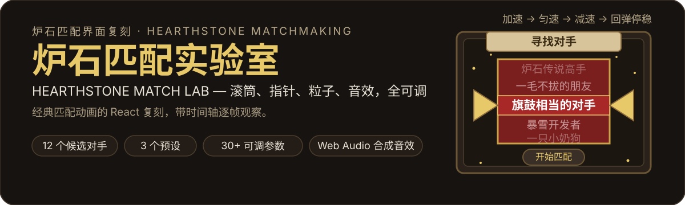
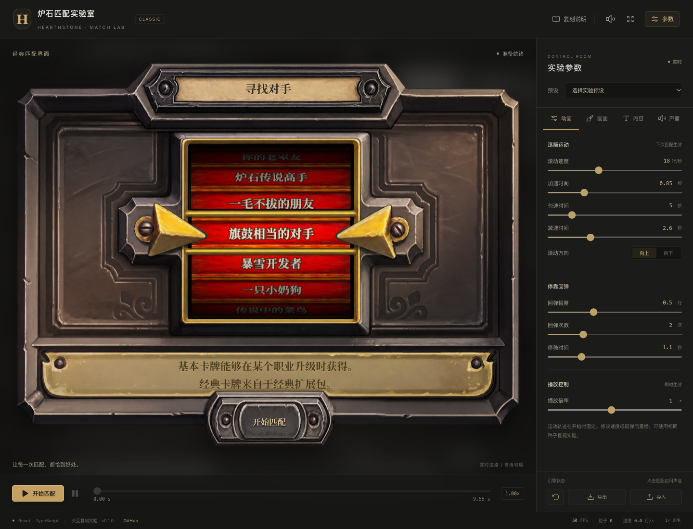

<p align="right"><a href="README.en.md">English</a></p>

<p align="center">
  
</p>

<p align="center">
  <a href="https://hearthstone-match.xiaosang.cc/">▶ 在线体验</a>
  ·
  <a href="https://github.com/holynova/hearthstone-match">GitHub 仓库</a>
</p>

炉石匹配实验室：经典炉石匹配界面的 React 复刻——金色边框、红色名牌滚筒、左右指针，加速、匀速、减速、回弹停稳全过程可调。点「开始匹配」，看滚筒转起来；拖时间轴，逐帧观察指针抖动与粒子。音效全部由 Web Audio 实时合成，不用任何音频文件。

## 截图

<p align="center">
  
</p>

<p align="center">
  
</p>

## 可以调什么

- **动画**：滚动速度、加速 / 匀速 / 减速 / 停稳时长、滚动方向、回弹幅度与次数、播放倍率。
- **画面**：指针抖动、模糊、辉光、字号、缩放、亮度、粒子数量 / 速度 / 寿命 / 重力 / 大小。
- **内容**：标题、底部提示、候选对手名单（每行一个，可用 `|` 设权重）、指定匹配结果、随机种子。
- **声音**：总音量、机械声、成功音、背景音乐音量、静音。
- **3 个预设**：经典复刻、慢动作观察、强化动效，一键切换。
- **导入 / 导出**：配置存为 JSON 分享给别人，或导入别人的配置复现同一场匹配；同一随机种子保证结果可复现。

默认 12 个候选对手：你的老室友、炉石传说高手、一毛不拔的朋友、旗鼓相当的对手、暴雪开发者、一只小奶狗、传说中的菜鸟、愤怒的小鸡、星际争霸冠军、旅店老板、打牌很慢的人、你最好的朋友。

## 逐帧观察

底部时间轴可暂停、拖动，配合慢动作预设，能看清滚筒在每个阶段的速度变化与指针抖动；引擎状态栏实时显示 FPS、粒子数与当前速度。匹配分 7 个阶段：待机 → 加速 → 匀速 → 减速 → 停稳 → 完成 / 取消。

## 本地运行

```bash
npm ci
npm run dev      # 开发
npm run build    # 构建
npm test         # 引擎测试（4 个用例）
```

## 技术

- React 19 + TypeScript + Vite 6；滚筒用 Canvas 渲染，运动学由纯函数引擎（`src/matchmaker/engine.ts`）计算，与渲染分离，可独立测试。
- 音效：Web Audio 合成 5 种声音（开始 / 刻度 / 成功 / 取消 / 音乐），无音频文件。
- 随机种子算法保证同一配置复现同一结果；配置导入时做校验与数值范围钳制。
- 组件 API 与交互细节见 `docs/component-api.md`。

```
src/matchmaker/engine.ts     运动学引擎：分阶段采样、种子随机、权重抽取
src/matchmaker/renderer.ts   Canvas 渲染：滚筒、指针、粒子
src/matchmaker/audio.ts      Web Audio 合成音效
src/matchmaker/options.ts    参数定义、默认值、预设、配置校验
src/OptionsPanel.tsx         右侧实验参数面板
tests/engine.test.ts         引擎测试（4 个用例）
```

非官方界面复刻，不连接真实匹配服务。
